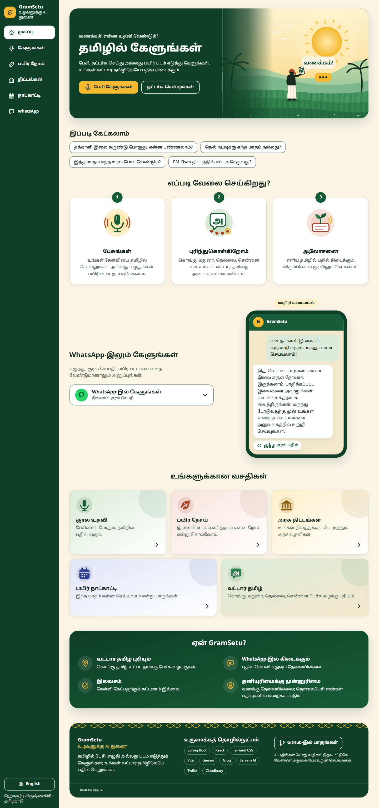
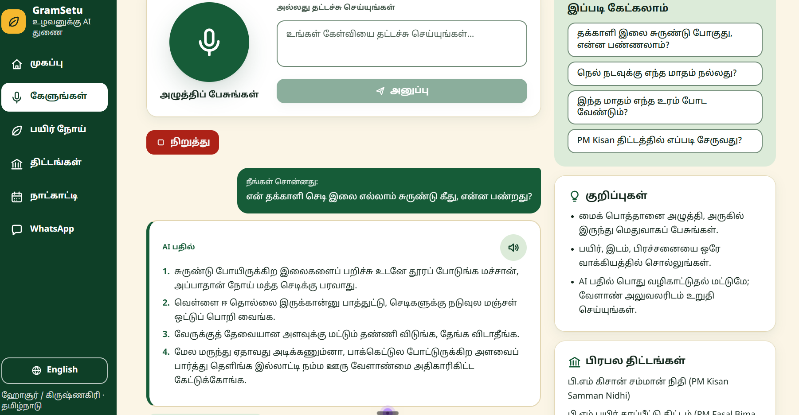
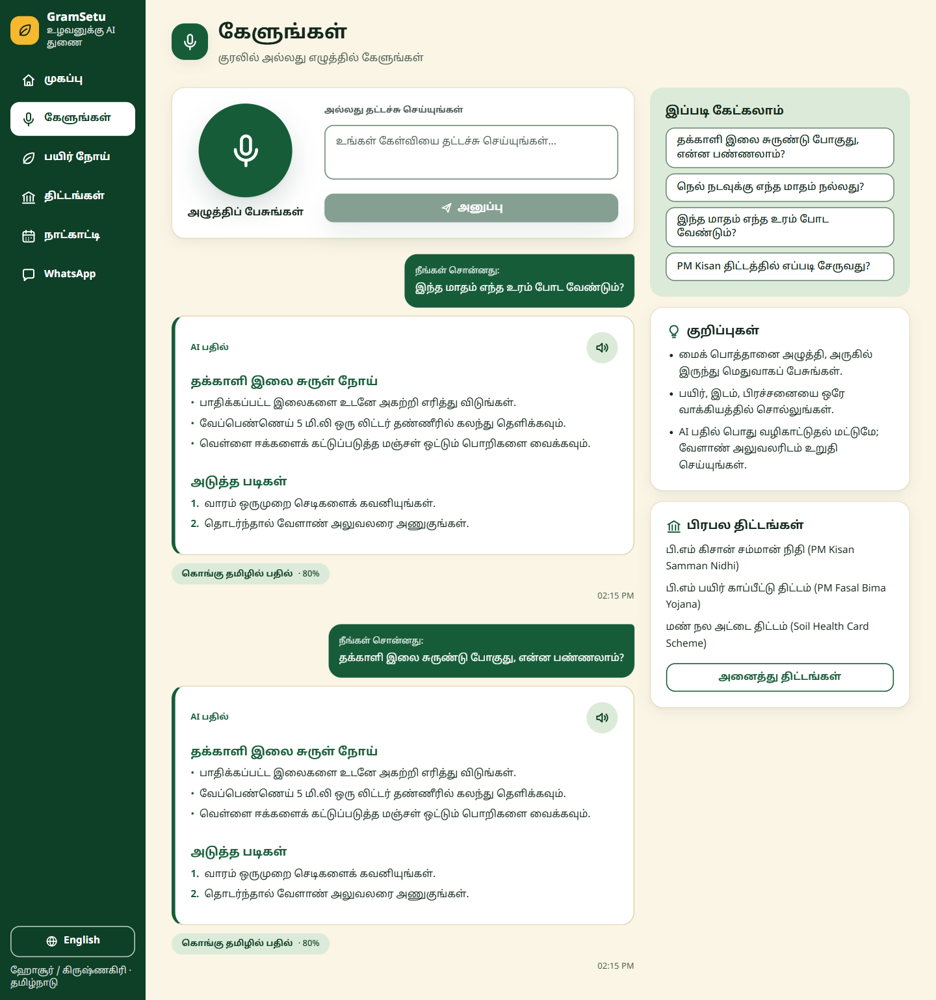
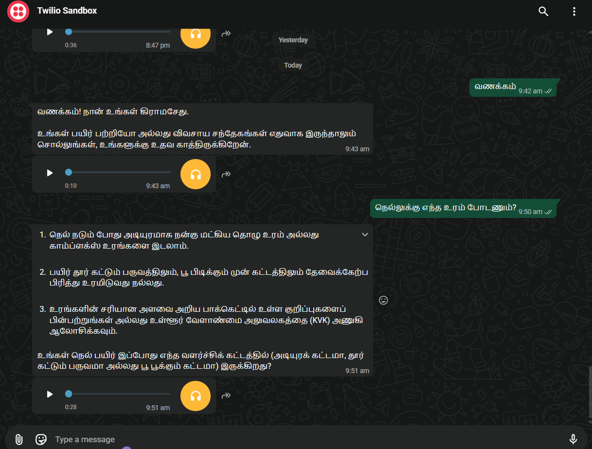
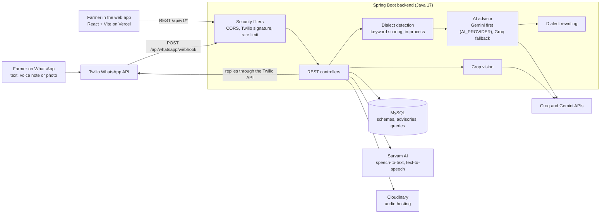
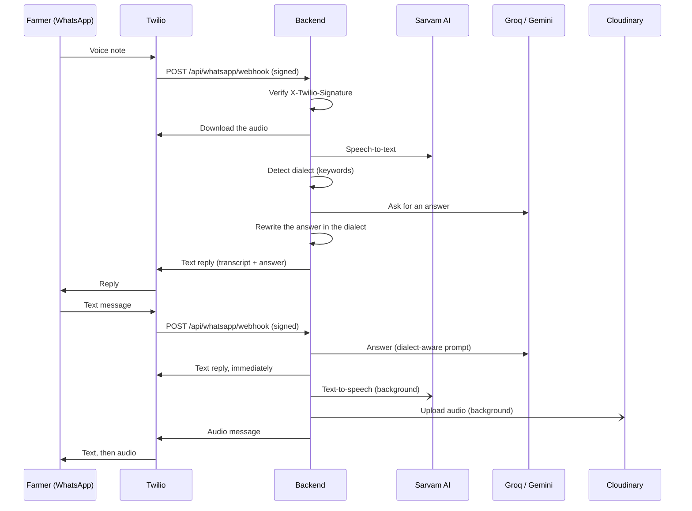

# GramSetu — a Tamil-first AI assistant for farmers

[](https://github.com/vasuki3009/gramsetu-ai/actions/workflows/ci.yml)

GramSetu (கிராம்சேது, "village bridge") lets a farmer ask a farming question **by voice, by text or with a photo of a sick
crop**, on the **web** or on **WhatsApp**, and get a short, practical answer in **their own regional Tamil dialect**
(Kongu, Madurai, Nellai or Chennai), often with a spoken reply.

| | |
|---|---|
| **Frontend** | **Live:** <https://gramsetu-livid.vercel.app> |
| **Backend API** | Runs on Render's free plan. It sleeps when idle, so the first request after a quiet period takes 50-80 seconds. Its data is in memory and resets on restart. |
| **Stack** | Spring Boot 3 · React 18 · MySQL 8 · Twilio WhatsApp · Gemini · Groq · Sarvam AI |

> AI answers are general guidance, not a substitute for a local agricultural officer or a plant-health professional.

## Contents

[Problem](#problem) · [Origin](#origin) · [Features](#features) · [Screenshots](#screenshots) · [Architecture](#architecture) · [Engineering story](#engineering-story-an-unreliable-ai) ·
[Tech stack](#tech-stack) · [Getting started](#getting-started) · [Configuration](#configuration) · [API](#api-overview) ·
[WhatsApp & Twilio sandbox](#whatsapp-and-the-twilio-sandbox) · [WhatsApp commands](#whatsapp-commands) ·
[How the AI answers](#how-the-ai-answers) · [Deployment](#deployment-notes) ·
[Security & reliability](#security--reliability) · [Limitations](#limitations) · [Future work](#future-work) ·
[Project layout](#project-layout)

## Problem

The premise GramSetu is built on: most digital farming advice is written in standard language, behind menus and typing.
Many farmers speak a regional dialect, prefer talking to typing, and already use WhatsApp every day. GramSetu meets them
there: a spoken or typed question in everyday Tamil goes in, and a short answer in the same dialect comes back, with
disease diagnosis from a photo, government-scheme lookup and a crop calendar alongside.

## Origin

What the repository itself shows about how the project started and grew (from the git history):

- **2026-03-19** — the first commit, "complete GramSetu AI-powered farmer assistance app" (Spring Boot + React); the same
  day it gained built-in sample answers for when API keys are not configured.
- **2026-03-20 → 03-24** — Docker setup, a mini "agent" that matches government schemes to a question, a crop calendar,
  Tamil/English UI, voice input and spoken answers, and the first dialect-aware answers.
- **2026-03-25 → 03-27** — the **WhatsApp bot** (Twilio): text, voice notes and photos, tests, and an ngrok workflow for demos.
- **2026-04-08 → 04-11** — audio replies via Cloudinary, rewriting answers into the detected dialect (Kongu, Madurai,
  Nellai, Chennai), a structured four-part answer format, Groq as the primary model with Gemini as fallback.
- **2026-11** — answer quality pass: Gemini is the primary model again (`AI_PROVIDER` switches it), one system prompt
  (`AdvisorPrompts`) with safety rules (no pesticide doses, ask one clarifying question, never invent scheme amounts), and
  the retired `gemini-2.0-flash` replaced by `gemini-3.8-flash`.
- **2026-04 → 06** — the web app became Tamil-only and was deployed (frontend on Vercel).
- **2026-11** — a hardening pass: environment-only configuration, signature-checked webhook, rate limits, privacy-safe logs.

The earliest defaults are centred on **Hosur and Krishnagiri** in Tamil Nadu (the first dialect default was Kongu), and
the crop calendar covers five districts: Thanjavur, Coimbatore, Krishnagiri, Dindigul and Tirunelveli.

**Why I built this.** A friend's grandfather is a farmer, and I saw how hard it was for him to get timely advice about his crops. GramSetu began for the TNWISE hackathon, but I wanted it to solve that real problem. A farmer can ask in Tamil, by text or voice, on WhatsApp, which they already use every day, and get an answer they can read or listen to. It is built with Spring Boot, Gemini for the advice (with fallback models), Sarvam AI for Tamil speech, and a React web app.

## Features

- **Ask by voice or text** — record or type in Tamil; the app transcribes, answers and speaks the answer.
- **Dialect-aware answers** — the dialect is detected from the wording (keyword scoring) and the answer is rewritten in
  that dialect: Kongu, Madurai, Nellai, Chennai, or standard Tamil.
  On WhatsApp a farmer can choose a dialect by sending `dialect chennai | madurai | nellai | kongu | standard`
  (or `சென்னை தமிழ்`, `மதுரை தமிழ்`, `நெல்லை தமிழ்`, `கொங்கு தமிழ்`); the choice is used for later messages.
- **Crop disease diagnosis** — upload a leaf photo; Gemini Vision diagnoses it and the result is cross-checked against
  stored crop advisories, with treatment and prevention steps (also read aloud).
- **Government schemes** — a question is matched to seeded schemes such as PM-KISAN, PMFBY (crop insurance), Soil Health Card,
  PM Kisan Maan Dhan and Kisan Credit Card.
- **Crop calendar** — month-by-month calendars for five districts, plus a personalised plan generated from crop, soil, acreage
  and season.
- **WhatsApp bot** — send text, a voice note or a photo. Text gets an immediate reply followed by an audio message;
  photos get a diagnosis with audio; voice notes get a text reply that includes what the bot heard. The reply is in the language you write in; send
  `english` or `tamil` to set the language for unclear messages such as "ok" or a number.
- **Resilient by design** — answers fall back from the chosen AI provider to the other one to built-in sample answers; dialect detection and text-to-speech
  failures never block a reply.

## Screenshots

<p align="center">
  <br>
  <em>Home</em>
</p>

<p align="center">
  <br>
  <em>Ask in Tamil: the answer in the farmer's dialect, with a speaker button to hear it read aloud</em>
</p>

<p align="center">
  <br>
  <em>Ask, desktop layout</em>
</p>

<p align="center">
  <br>
  <em>WhatsApp: Tamil text and audio replies</em>
</p>

## Architecture



Dialect detection is plain keyword scoring inside the backend (`DialectDetectionService`); there is no separate ML
service. The web app uses the same backend and gets audio back in the JSON response.

**What happens to each kind of WhatsApp message**



A photo follows the crop-vision path: resize to 1024 px → Gemini Vision → match stored advisories → text reply plus a
spoken summary.

## Engineering story: an unreliable AI

On Gemini's free tier, answers often failed with 503 and 429 errors, and my first 8-second timeout plus one shared time budget meant the fallback models were never reached. I found this in the Render logs and rebuilt the chain: a longer per-model timeout and budget, retries on 429/5xx/timeouts, fallback Gemini models, and a clearly marked sample answer if everything fails. I also made the WhatsApp webhook return immediately and reply asynchronously. Lesson: never trust an external API to be up; design the fallback first.

## Tech stack

| Layer | Technology | Purpose |
|---|---|---|
| Backend | Java 17, Spring Boot 3.2.5 (Web, Data JPA) | REST API, webhook, orchestration |
| Database | MySQL 8.0 | Schemes, crop advisories, dialect words, query log |
| Messaging | Twilio SDK 9.14.1 (WhatsApp) | Receive and send WhatsApp messages, signature validation |
| Media hosting | Cloudinary 1.36.0 | Public URLs for audio that Twilio delivers |
| Text AI | Google Gemini `gemini-3.8-flash` (`GEMINI_MODEL`), Groq `llama-3.3-70b-versatile` | Answers (Gemini first, Groq fallback; `AI_PROVIDER` switches the order), crop vision |
| Speech | Sarvam AI `saaras:v3` (STT), `bulbul:v3` (TTS), both configurable | Tamil speech-to-text and text-to-speech |
| Frontend | React 18, Vite 5, Tailwind CSS 3, React Router 6, axios | Tamil-first web app |
| Build & run | Maven 3.9, Docker, Docker Compose | Local stack and container image |
| Hosting | Vercel (frontend); Render free plan (backend, Docker + in-memory H2) | Deployment |
| Testing | JUnit 5, Mockito, Spring MockMvc | Unit and web-layer tests |

## Getting started

**Prerequisites:** Git, JDK 17, Maven 3.9+, Node.js 18+, Docker (for MySQL or the full stack), and accounts for
[Gemini](https://aistudio.google.com/app/apikey), [Sarvam AI](https://dashboard.sarvam.ai),
[Twilio](https://www.twilio.com/try-twilio) and [Cloudinary](https://cloudinary.com). Groq is optional.

```bash
git clone https://github.com/vasuki3009/gramsetu-ai.git
cd gramsetu-ai
cp .env.example .env        # then edit .env: replace every placeholder (see Configuration below)
```

### Option A — everything in Docker (MySQL + backend)

```bash
docker compose up --build
curl http://localhost:8081/api/whatsapp/health      # {"status":"UP"}  (503 {"status":"DOWN"} if unhealthy)
```

The backend is now on <http://localhost:8081>. Compose stops with a clear message if a required variable is missing.
Stop it with `docker compose down` (add `-v` to also delete the database volume).

### Option B — run the backend from source (MySQL in Docker)

```bash
docker compose up -d gramsetu-mysql
```

Then, in **bash**:

```bash
set -a; source .env; set +a
export SPRING_PROFILES_ACTIVE=dev
export SPRING_DATASOURCE_URL="jdbc:mysql://localhost:${MYSQL_HOST_PORT:-3307}/${MYSQL_DATABASE:-gramsetu}?useSSL=false&serverTimezone=UTC&allowPublicKeyRetrieval=true"
export SPRING_DATASOURCE_USERNAME=root
export SPRING_DATASOURCE_PASSWORD="$MYSQL_ROOT_PASSWORD"
mvn spring-boot:run
```

or in **PowerShell**:

```powershell
Get-Content .env | Where-Object { $_ -match '^\s*[^#\s][^=]*=' } | ForEach-Object { $k, $v = $_ -split '=', 2; Set-Item "Env:$($k.Trim())" $v.Trim() }
$env:SPRING_PROFILES_ACTIVE = 'dev'
$env:SPRING_DATASOURCE_URL = "jdbc:mysql://localhost:$($env:MYSQL_HOST_PORT)/$($env:MYSQL_DATABASE)?useSSL=false&serverTimezone=UTC&allowPublicKeyRetrieval=true"
$env:SPRING_DATASOURCE_USERNAME = 'root'
$env:SPRING_DATASOURCE_PASSWORD = $env:MYSQL_ROOT_PASSWORD
mvn spring-boot:run
```

The `dev` profile turns on SQL and DEBUG logging (which includes farmers' text — never use it in production).
For local `curl` tests without Twilio, set `TWILIO_VALIDATE_SIGNATURE=false` and keep a placeholder `APP_PUBLIC_BASE_URL`.

### Frontend

```bash
cd gramsetu-app
cp .env.example .env.local   # VITE_API_BASE_URL defaults to http://localhost:8081 in dev
npm ci
npm run dev                  # http://localhost:5173
```

### Tests and build

```bash
mvn test                     # backend tests
mvn -DskipTests package      # builds target/gramsetu-backend-1.0.0.jar
cd gramsetu-app && npm run build   # production build (needs VITE_API_BASE_URL, see below)
```

## Configuration

All backend configuration is read from environment variables; there are no defaults for credentials or hosts.
[`.env.example`](.env.example) is the template (frontend: [`gramsetu-app/.env.example`](gramsetu-app/.env.example)).

### Backend

| Variable | Required | Default | Description |
|---|---|---|---|
| `PORT` | no | `8081` | Port the backend listens on (hosting platforms such as Render set it) |
| `SPRING_PROFILES_ACTIVE` | no | empty | `dev` for local development; leave empty in production |
| `MYSQL_ROOT_PASSWORD` | yes (Docker) | – | Root password for the compose MySQL container (applies when the volume is first created) |
| `MYSQL_DATABASE` | no | `gramsetu` | Database name |
| `MYSQL_HOST_PORT` | no | `3307` | Host port MySQL is published on (localhost only) |
| `SPRING_DATASOURCE_URL` | yes (no Docker) | – | JDBC URL, when not using compose |
| `SPRING_DATASOURCE_USERNAME` | yes (no Docker) | – | Database user, when not using compose |
| `SPRING_DATASOURCE_PASSWORD` | yes (no Docker) | – | Database password, when not using compose |
| `GEMINI_API_KEY` | yes | – | Google Gemini (answers by default, crop vision) |
| `SARVAM_API_KEY` | yes | – | Sarvam AI speech-to-text and text-to-speech |
| `SARVAM_TTS_MODEL` | no | `bulbul:v3` | Sarvam text-to-speech model (`bulbul:v2` is retired). Speakers are set in `SarvamTtsVoices` and must match the model |
| `SARVAM_STT_MODEL` | no | `saaras:v3` | Sarvam speech-to-text model (`saarika:v2` / `v2.5` are legacy) |
| `GROQ_API_KEY` | no | empty | Groq key: the fallback (or the primary when `AI_PROVIDER=groq`) |
| `AI_PROVIDER` | no | `gemini` | `gemini` or `groq`: which AI answers first; the other is the fallback if its key is set |
| `DEFAULT_DIALECT` | no | `standard` | Dialect used when none is detected: `standard`, `kongu`, `madurai`, `nellai` or `chennai` |
| `GEMINI_MODEL` | no | `gemini-3.8-flash` | Gemini model for answers and crop photos |
| `GEMINI_FALLBACK_MODELS` | no | `gemini-3.6-flash,gemini-3.5-flash-lite` | Models tried after the primary one keeps failing, then Groq. Empty = none |
| `AI_TEMPERATURE` | no | `0.2` | Answer randomness (low = steady) |
| `AI_MAX_OUTPUT_TOKENS` | no | `2048` | Longest answer, in tokens (Tamil uses many) |
| `TWILIO_ACCOUNT_SID` | yes | – | Twilio account SID |
| `TWILIO_AUTH_TOKEN` | yes | – | Twilio auth token (also used to verify webhook signatures) |
| `TWILIO_WHATSAPP_FROM` | yes | – | WhatsApp sender, e.g. `whatsapp:+1…` |
| `APP_PUBLIC_BASE_URL` | yes | – | Public HTTPS URL of this backend exactly as Twilio calls it; the signature is checked against it |
| `TWILIO_VALIDATE_SIGNATURE` | no | `true` | `false` only for local curl testing, never on a server |
| `CLOUDINARY_CLOUD_NAME` | yes | – | Cloudinary cloud name |
| `CLOUDINARY_API_KEY` | yes | – | Cloudinary API key |
| `CLOUDINARY_API_SECRET` | yes | – | Cloudinary API secret |
| `CORS_ALLOWED_ORIGINS` | no | empty (none) | Comma-separated exact origins allowed to call the API; compose and `dev` default to `http://localhost:5173` |
| `CORS_ALLOWED_ORIGIN_PATTERNS` | no | empty | Optional origin patterns, e.g. this project's Vercel previews; never a bare `*.vercel.app` |
| `RATE_LIMIT_ENABLED` | no | `true` | Per-IP rate limit on the AI-backed endpoints |
| `RATE_LIMIT_PER_MINUTE` | no | `20` | Requests per IP per minute |
| `RATE_LIMIT_TRUSTED_PROXY_HOPS` | no | `1` (compose: `0`) | Reverse proxies in front of the app; see [Security](#security--reliability) |
| `MAX_UPLOAD_SIZE` | no | `8MB` | Hard ceiling for uploaded files |
| `MAX_AUDIO_BYTES` | no | `2097152` | Largest accepted voice recording (2 MB) |
| `MAX_IMAGE_BYTES` | no | `8388608` | Largest accepted crop photo (8 MB) |
| `MAX_QUESTION_LENGTH` | no | `1000` | Maximum characters in a text question |
| `CACHEBUST` | no | `1` | Docker build argument; change it to force a fresh compile |

### Frontend (`gramsetu-app`)

| Variable | Required | Default | Description |
|---|---|---|---|
| `VITE_API_BASE_URL` | **yes in production** | `http://localhost:8081` in `npm run dev` only | Backend base URL. A production build **fails** if it is missing, and the app throws at start-up as a second guard. |
| `VITE_WHATSAPP_JOIN_URL` | no | empty | Full WhatsApp join link for the home-screen button and QR code (hidden when empty) |

## API overview

| Method & path | Purpose | Notes |
|---|---|---|
| `POST /api/v1/farmer/ask` | Text question → answer, dialect, audio | Rate-limited; question ≤ `MAX_QUESTION_LENGTH` |
| `POST /api/v1/farmer/voice` | Voice recording → transcript, answer, audio | Rate-limited; audio ≤ `MAX_AUDIO_BYTES` |
| `POST /api/voice/process` | Voice pipeline for uploaded audio | Rate-limited |
| `POST /api/v1/crop/analyze` | Crop photo → diagnosis, treatment | Rate-limited; images only |
| `GET /api/v1/crop/advisories` | Stored crop advisories | |
| `POST /api/v1/schemes/find` · `GET /api/v1/schemes/all` | Scheme matching · scheme list | `find` is rate-limited |
| `GET /api/v1/crops/calendar` · `POST /api/v1/crops/calendar/plan` | Calendar · personalised plan | `plan` is rate-limited, inputs validated |
| `POST /api/whatsapp/webhook` | Twilio WhatsApp webhook | Requires a valid `X-Twilio-Signature` |
| `GET /api/whatsapp/health` | Liveness for Docker, Render and monitors: `{"status":"UP"}` or `503 {"status":"DOWN"}` | Public and minimal; the component report is dev-profile only |

## WhatsApp and the Twilio sandbox

The bot is developed against the **Twilio WhatsApp Sandbox**, which is for testing only:

1. In the Twilio console open **Messaging → Try it out → Send a WhatsApp message** and note the sandbox number and your
   join code.
2. From your phone, send `join <your-join-code>` to the sandbox number on WhatsApp. Sandbox participants must **re-join
   periodically** (Twilio currently expires sandbox sessions after 72 hours), and only people who have joined can talk to it.
3. Set **"When a message comes in"** to `https://<your-backend>/api/whatsapp/webhook` (method `POST`).
4. Set `APP_PUBLIC_BASE_URL` to that same `https://<your-backend>` — requests are rejected unless their signature matches it.
5. Locally, expose the backend with `scripts\start-ngrok.bat`, use the ngrok URL for steps 3–4, and restart the backend.

A production bot needs an approved WhatsApp Business sender; the sandbox cannot message people who have not joined.
`scripts\test-webhook.bat` sends simulated (unsigned) messages and needs `TWILIO_VALIDATE_SIGNATURE=false` on a local backend.

## WhatsApp commands

Send these as the whole message; upper or lower case does not matter. Anything else is treated as a question.

| Send | What happens |
|---|---|
| `reset`, `புதிதாக` or `புது கேள்வி` | Clears the bot's short-term memory of your chat (the last 3 question/answer pairs) and confirms in Tamil. |
| `dialect chennai`, `dialect madurai`, `dialect nellai`, `dialect kongu` or `dialect standard` | Answers in that dialect from now on, instead of guessing it from your words. `dialect: chennai` also works. |
| `சென்னை தமிழ்`, `மதுரை தமிழ்`, `நெல்லை தமிழ்` or `கொங்கு தமிழ்` | The same, in Tamil. There is no Tamil form for standard: send `dialect standard`. |
| `english`, or `tamil` / `தமிழ்` | Sets the language used when a message is unclear ("ok", a number, Tamil typed in English letters). Otherwise the reply follows the language you write in. |

Greetings and small talk ("hello", "வணக்கம்", "thanks") are not commands. They get a short, friendly reply written by
the AI (not a fixed text), and they are not kept in the memory. The fixed texts are the welcome message (for an empty
message), the "AI is busy" note and the error messages. You can also send a photo of a leaf (crop diagnosis) or a voice
note (answered in text). The dialect and language choices are kept in memory only, so they are lost on a restart.

## How the AI answers

- **Gemini first.** Text answers come from Gemini (`GEMINI_MODEL`); if it is busy the fallback Gemini models
  (`GEMINI_FALLBACK_MODELS`) are tried, then Groq if `GROQ_API_KEY` is set (Groq can also be made the primary with
  `AI_PROVIDER=groq`).
- **A marked sample answer when the AI is busy.** If no provider answers, the farmer gets a built-in general-guidance
  answer that starts with an "AI is busy" note, so it is never mistaken for a real AI answer.
- **The language of the question.** On the website the answer is in English when the language button is English, or
  when the question has no Tamil script and is clearly English; otherwise it is in Tamil. On WhatsApp the question
  decides (Tamil script gives Tamil, a clear English question gives English) and the `english` / `tamil` command only
  settles unclear messages. An English answer is asked for in English only, with no Tamil dialect and no dialect
  header. Tamil typed in English letters counts as Tamil. The answers are short, numbered steps; when information is missing the AI first gives safe general guidance
  and then asks one question. It gives no pesticide or fertiliser doses (it points to the product label and the local
  agriculture office or KVK).
- **Speech.** Speech-to-text uses Sarvam `saaras:v3` (Tamil mode listens for Tamil; English mode on the website lets
  Sarvam detect the language) and text-to-speech uses Sarvam `bulbul:v3` (Tamil dialect voices for Tamil answers, the
  English `en-IN` voice for English answers). Audio is best-effort: the text reply is always sent first, and if speech
  cannot be made the farmer gets the text only (the website then falls back to the browser's own voice).

## Deployment notes

The web app runs on **Vercel** and the backend runs on **Render's free plan**.

**Backend → Render (free plan)**

- Deployed from [`render.yaml`](render.yaml) as a Render **Blueprint**: one Docker web service (`gramsetu-backend`) built from the
  root `Dockerfile`. Render supplies `$PORT`, which the app reads.
- Health check path: `/api/whatsapp/health`. It answers `200` when healthy.
- Spring profile `render` (`SPRING_PROFILES_ACTIVE=render`, already set in `render.yaml`) uses an **in-memory H2 database**
  (MySQL mode), so there is no database to provision. **Data resets whenever the service restarts or sleeps.**
- Free services spin down when idle: the **first request after a quiet period takes about 50-80 seconds**.
- Set `APP_PUBLIC_BASE_URL` to the service's public HTTPS URL and use `<that URL>/api/whatsapp/webhook` in Twilio.
- Set `CORS_ALLOWED_ORIGINS=https://gramsetu-livid.vercel.app`.

Environment variables a deployer needs (names only; enter the values in the Render dashboard, never in the repository).
Already set in `render.yaml`: `SPRING_PROFILES_ACTIVE`, `JAVA_TOOL_OPTIONS`, `AI_PROVIDER`.
Entered by hand (`sync: false`):

| Variable | Needed for |
|---|---|
| `GEMINI_API_KEY` | AI answers and crop-photo diagnosis |
| `SARVAM_API_KEY` | Tamil speech-to-text and text-to-speech |
| `TWILIO_ACCOUNT_SID`, `TWILIO_AUTH_TOKEN`, `TWILIO_WHATSAPP_FROM` | WhatsApp bot |
| `APP_PUBLIC_BASE_URL` | Twilio signature check and webhook URL |
| `CLOUDINARY_CLOUD_NAME`, `CLOUDINARY_API_KEY`, `CLOUDINARY_API_SECRET` | Crop-photo storage |
| `CORS_ALLOWED_ORIGINS` | Allowing the web app to call the API |

Optional (see [`.env.example`](.env.example)): `GROQ_API_KEY`, `GEMINI_MODEL`, `GEMINI_FALLBACK_MODELS`, `AI_RETRY_MAX_ATTEMPTS`,
`AI_RETRY_BUDGET_MS`, `AI_READ_TIMEOUT_MS`, `AI_THINKING_LEVEL`, `AI_TEMPERATURE`, `AI_MAX_OUTPUT_TOKENS`, `SARVAM_TTS_MODEL`,
`SARVAM_STT_MODEL`, `DEFAULT_DIALECT`, `TWILIO_VALIDATE_SIGNATURE`, `CORS_ALLOWED_ORIGIN_PATTERNS`, `RATE_LIMIT_ENABLED`,
`RATE_LIMIT_PER_MINUTE`, `RATE_LIMIT_TRUSTED_PROXY_HOPS`, `MAX_UPLOAD_SIZE`, `MAX_AUDIO_BYTES`, `MAX_IMAGE_BYTES`,
`MAX_QUESTION_LENGTH`.

**Frontend → Vercel**

- Project root directory: `gramsetu-app`; framework preset: Vite; build command `npm run build`; output `dist`.
- Environment variables: `VITE_API_BASE_URL` (the backend's public URL; **required**, and read **at build time**, so the build
  fails without it and a change needs a redeploy) and `VITE_WHATSAPP_JOIN_URL` (optional: without it the home-screen WhatsApp
  button and QR code are hidden). Set them for *Production* (and *Preview* if you use previews) **before** merging,
  switching the production branch or redeploying. Delete any old `VITE_API_URL`: nothing reads it.
- [`gramsetu-app/vercel.json`](gramsetu-app/vercel.json) rewrites every path to `index.html`, so deep links such as
  `/voice` work after a refresh.

## Security & reliability

What this codebase does, and the assumptions behind it.

**Request authenticity and access**

- **Signed webhook.** `POST /api/whatsapp/webhook` is rejected with `403` unless `X-Twilio-Signature` validates against
  `APP_PUBLIC_BASE_URL` and the auth token. Startup fails if validation is on but the token or URL is missing.
  `TWILIO_VALIDATE_SIGNATURE=false` exists for local testing only and logs a warning.
- **One CORS policy.** An explicit origin allow-list (`CORS_ALLOWED_ORIGINS`), no wildcard, no credentials. It runs as the first
  servlet filter, so even `403` and `429` responses carry CORS headers and the browser can read them.
- **Per-IP rate limiting** on every endpoint that calls a paid AI API (default 20 requests/minute, `429` with `Retry-After`).
  *Assumption:* the client IP is taken from `X-Forwarded-For`, counting `RATE_LIMIT_TRUSTED_PROXY_HOPS` entries from the
  right (left entries are forgeable). Use `1` behind one platform proxy, `0` if the app is exposed directly,
  and a higher number if more proxies are chained — otherwise clients can evade the limit or share one budget.
- **Request limits.** Maximum upload size, voice recording size (413), image size, text length (400), images-only uploads, and bounded,
  validated inputs for the crop-plan form, whose values are inserted into an LLM prompt.
- **Smaller attack surface.** The unauthenticated "recent questions" endpoint and an unused audio endpoint were removed, and
  every controller-level `@CrossOrigin` (which would have bypassed the allow-list) is gone and guarded by a test.

**Secrets and privacy**

- **Environment-only secrets.** No keys, passwords, hosts or phone numbers in the code; configuration has no credential defaults and
  fails fast with a message naming the missing variable. The Gemini key is sent in a header, not in the URL.
- **Privacy-safe logs.** At INFO the logs contain lengths, ids and masked numbers (`whatsapp:+91********00`); transcripts, questions
  and answers are logged only at DEBUG, which only the `dev` profile enables. A logging filter also redacts URLs and
  `key=`/`token=` values, and Cloudinary errors mask the configured credentials.
- **Minimal public health endpoint.** `GET /api/whatsapp/health` returns only `{"status":"UP"}` (or `503 {"status":"DOWN"}`); the
  component report with key flags and database counts is only available in the `dev` profile.
- **Containers.** The image runs as a non-root user, MySQL is published on `127.0.0.1` only, and the health check does not put the
  password in the config.

**Reliability**

- Answer fallback chain: the provider chosen by `AI_PROVIDER` (Gemini by default) → the fallback Gemini models (`GEMINI_FALLBACK_MODELS`) → the other provider if its key is set → built-in sample answers (general guidance, no doses, shown with an "AI is busy" note). A 429 or 5xx is retried once on the same model (`AI_RETRY_MAX_ATTEMPTS`=2, 1 s backoff) while the `AI_RETRY_BUDGET_MS` budget (60 s) lasts; a timeout (`AI_READ_TIMEOUT_MS`, 25 s) moves straight to the next model, and every model always gets at least one attempt. WhatsApp replies are sent in the background, so the longer waits do not hit the Twilio webhook timeout. `AI_THINKING_LEVEL` (default `low`) keeps Gemini thinking short for faster answers. Dialect detection never fails a request, and a text-to-speech or
  Cloudinary failure degrades to a text-only reply (uploads have timeouts and a null-safe delivery path).
- In-memory structures are bounded: the WhatsApp language preference map is an LRU of 10,000 entries, and the background
  audio replies run on a small worker pool with a 50-job queue (when it is full the audio is skipped, the text reply is
  still delivered).
- Voice notes are answered with text only, so no speech is synthesised for them.
- Tests cover the signature filter (valid, invalid, missing, tampered, disabled), CORS, rate limiting, size/length limits, log redaction,
  the Cloudinary service and its Spring wiring.

**Known limitations**

- The web API is anonymous (no accounts); it is protected by rate and size limits only.
- The rate limiter and WhatsApp language preferences are in memory, per instance: they reset on restart and are not shared between replicas.
- The schema is managed by `ddl-auto=update`; there are no migrations yet.

## Limitations

- **Dialect detection is keyword-based, not machine learning.** Each dialect has a list of marker words: strong ones
  (colloquial verb endings, pronouns, slang) score 2 and weak ones (common everywhere, or only a place name) score 1.
  A dialect is chosen only when its score is at least 2 and no other dialect ties it; otherwise `DEFAULT_DIALECT`
  (standard Tamil unless changed) is used. The word lists are in `DialectDetectionService` (the `dialect_words`
  table in `data.sql` is seed data and is not read by detection). Known limits: it matches word fragments, so it can
  be fooled by a word that contains a marker; short messages usually carry no marker and get the default; mixed or
  Tanglish text is not understood; and the lists are small and hand-written, so some regional speech is missed. A farmer can
  override the detection on WhatsApp with `dialect <name>` (or the Tamil forms); that choice is kept in memory per
  number (an LRU of 10,000 numbers) and is lost on restart. Logs show only the dialect and whether it was
  detected, overridden or the default, never the message text.
- **WhatsApp language preferences live in memory** (an LRU of 10,000 numbers) and reset on every restart. They only
  matter for unclear messages, because the language of the question decides the reply. Detecting English is a simple
  word check, so a very short or mixed message can be taken as Tamil; voice notes are still transcribed as Tamil.
- **WhatsApp conversation memory is in-memory only.** The last 6 messages (3 question/answer pairs) per number are
  sent to the AI as context so follow-ups work. Nothing is stored in the database or on disk, it is lost on every
  restart, a conversation expires after 30 minutes of inactivity, and at most 2,000 numbers are kept (least recently
  used dropped first). Greetings, fixed replies and sample/fallback answers are not remembered. Sending `reset`,
  `புதிதாக` or `புது கேள்வி` clears it. It applies to typed messages only, not voice notes or photos.
- **Audio replies are best-effort.** Speech is uploaded to Cloudinary and sent as a link. If the upload fails or the
  50-job queue is full, the farmer gets the text reply only. The whole answer is spoken: it is cleaned of markdown,
  split into sentence-sized parts (at most 1,200 characters each, under Sarvam's 2,500 limit), each part is spoken and
  the mp3 parts are joined in order. Each part gets one retry; if a part still fails, or the answer needs more than 6
  parts, no audio is sent at all (text only) rather than audio that stops partway. The scheme list on the website is
  not spoken. Joined mp3 parts can have a tiny pause between them.
- **The WhatsApp demo runs on the Twilio sandbox.** Only people who have sent the join code can use it, and sandbox
  sessions expire (currently after 72 hours).
- **Free hosting sleeps.** On Render's free tier the backend spins down when idle, and a cold start takes about
  50-80 seconds, so the first request after a quiet period can be slow or time out.
- **In-memory data resets on restart.** The language and dialect choices, the conversation memory and the rate-limit
  counters live in memory only; nothing is saved when the backend restarts or sleeps.
- **The Gemini free tier can be busy.** It can answer 429 or 503 at busy times. The app retries, tries the fallback
  models and Groq, and finally sends the marked sample answer, but an answer can still be slow or generic.
- **AI advice is general guidance, not expert-verified.** Answers are not checked by an agronomist and can be wrong. They
  avoid doses and scheme amounts, and farmers are told to confirm with the local agriculture office or KVK.

## Future work

- Persist rate limits and language preferences (for example in Redis) so multiple replicas behave consistently.
- User accounts and a personal, private history of questions.
- Database migrations (Flyway) instead of `ddl-auto=update`; Actuator health and metrics.
- Dependency and secret scanning in CI, and a published coverage report.
- A learned dialect classifier to complement keyword scoring (an earlier experiment was dropped for being too heavy).
- More regional languages and districts, an installable offline-friendly web app, and a WhatsApp Business production sender.
- Audio hosted on storage you control (for example S3-compatible object storage with expiring links) instead of a third-party media host.
- Live mandi prices from data.gov.in, so answers can quote current market rates.

## Project layout

```
.
├── src/main/java/com/gramsetu/     Spring Boot backend
│   ├── controller/                 REST + WhatsApp webhook
│   ├── service/                    AI advisor, crop vision, dialect, speech, Cloudinary
│   ├── security/                   Twilio signature, rate limiting, client IP
│   ├── config/                     CORS and filter registration
│   ├── model/ repository/ dto/     JPA entities, repositories, DTOs
│   └── util/                       prompt builder, log and input helpers
├── src/main/resources/             application*.properties, data.sql (seed data), logback
├── src/test/java/                  backend tests
├── gramsetu-app/                   React + Vite frontend (Tamil-first UI)
├── scripts/                        ngrok and webhook test helpers (Windows)
├── docs/screenshots/               README images
├── Dockerfile · docker-compose.yml
└── .env.example                    configuration template
```

## License

Released under the [MIT License](LICENSE) — Copyright (c) 2026 vasuki3009.
